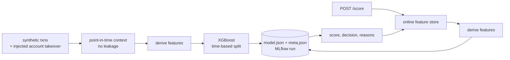

# fraud-scoring-mlops

Fraud-risk scoring from start to finish: synthetic transactions, point-in-time features, XGBoost, precision-targeted thresholds, optional MLflow tracking, and a FastAPI real-time scoring service shipped in Docker. **All data is synthetic.**

The main idea is **one feature definition for training and serving**. Offline, customer context is built only from earlier transactions. Online, it comes from a profile store. Both paths go through the same `derive()` function, and a test checks that they produce identical features.



## Results on synthetic data

`python -m fraud.train` on the default generator (800 customers, 30 days, time-based 80/20 split):

| ROC-AUC | PR-AUC | Precision @ thr | Recall @ thr | Test fraud rate |
|---|---|---|---|---|
| 0.997 | 0.88 | 0.90 | 0.80 | 0.8% |

The threshold is set as the lowest score that reaches the target precision (`--target-precision`, default 0.9). That trades recall for fewer false positives sent to manual review.

## Layout

| Path | Purpose |
|---|---|
| `fraud/data.py` | Generates customers with normal spend, legit noise (travel, big purchases, new phones) and account-takeover bursts |
| `fraud/features.py` | `point_in_time_context`, `OnlineFeatureStore`, shared `derive()` |
| `fraud/train.py` | Time split, class weighting, threshold selection, artifacts, MLflow logging |
| `fraud/serve.py` | FastAPI `/score` with validation, decision, human-readable reasons and latency |
| `Dockerfile` | Trains at build time and serves with uvicorn |
| `.github/workflows/ci.yml` | Tests, then Docker build |

## Run it

```bash
pip install -r requirements.txt
python -m fraud.train --out artifacts                 # add MLFLOW_TRACKING_URI=sqlite:///mlflow.db to track runs
MODEL_DIR=artifacts uvicorn fraud.serve:app

curl -s localhost:8000/score -H 'content-type: application/json' -d '{
  "txn_id": "t1", "customer_id": "c00001", "ts": "2026-02-01T03:00:00",
  "amount": 950, "country": "RO", "device_id": "unknown", "home_country": "US"}'
```

Or with Docker: `docker build -t fraud-scoring . && docker run -p 8000:8000 fraud-scoring`.

## Tests

```bash
pytest -q
```

The tests cover no-leakage context, online/offline feature parity, model quality floors, artifacts, scoring behaviour and input validation.

## Next steps

- Move the online store to Redis or Databricks Feature Serving and stream profile updates from Kafka
- Register models in the MLflow Model Registry with champion/challenger promotion
- Monitor score drift and label delay; retrain on a schedule
